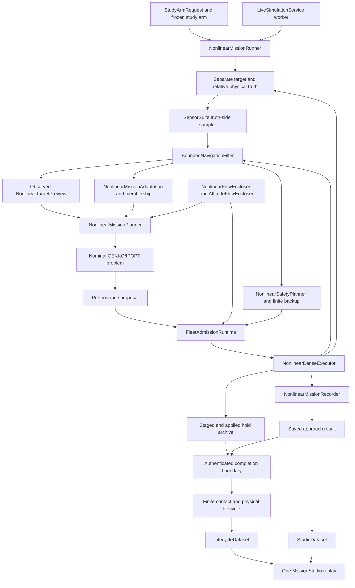

# ORBEX-A architecture

The maintained sensed nonlinear pipeline separates physical truth, bounded
observations, nominal GEKKO planning, held-command admission and recorded evidence.
The public Python package is `orbexa`; its checkout source is `scripts/`.
Analytical translation reproduction remains available under its own model and
clock identities. Sharing an interface or renderer does not equate these models.

## Entry points and composition

`NonlinearMissionRunner` composes one explicit `IndependentTruthCase` with
`NonlinearStudyOptions`, a vehicle design and structured `SimulationConfig`.
`orbexa-run-nonlinear` creates a `StudyArmRequest` for `run_study_arm`, which
freezes the selected source/configuration/case and runs the requested
adaptive/frozen and dynamic/fixed arm in a new output directory. The update cap
does not turn an unfinished approach into a completed mission.

`LiveSimulationService` uses this same nonlinear runner, planner, executor and
completion composition. Its worker boundary owns job control, frozen inputs and
committed projections; the browser consumes those projections. Historical
analytical resume is a separate, explicitly selected route. Neither entry point
implements a second controller or physical plant.

The arrows show responsibility and data flow. In particular, truth reaches the
controller through sensor packets and navigation; recorded truth and offline
containment diagnostics are separate outputs.

## Maintained module ownership

Paths in this table are relative to `scripts/`.

| Module | Main interfaces and responsibility |
|---|---|
| `core/config_types.py`, `core/config_loader.py`, `core/config.py` | Structured scenario validation, YAML loading and configuration composition |
| `contracts.py`, `layout.py`, `sessions.py` | Solver problem/result records, relocated-checkout paths and explicit generated-session ownership |
| `core/reference_frame.py` | `ReferenceClockFrame`: declared reference orbit, commanded anomaly clock and frame transforms |
| `core/nonlinear_relative.py` | `NonlinearModelBounds`, `ExponentialAtmosphere`, `NonlinearRelativeDynamics`: central gravity, J2, co-rotating vector drag and exact transformed relative RHS |
| `core/nonlinear_target.py` | `NonlinearTargetTruth` owns numerical Cartesian, quaternion and body-rate truth; `NonlinearTargetPreview` is updated from current navigation observations |
| `core/inertial_dynamics.py` | Independent Cartesian SI dynamics and frame calculations used to check the physical equations separately |
| `core/spacecraft_geometry.py`, `simulation/spacecraft_design.py` | Exact expanded component solids, patch geometry and prospective mass/actuator/contact declarations |
| `control/nonlinear_flow.py` | `NonlinearFlowEncloser`, `TargetEphemerisCertificate`, `RegionalResidualCertificate`: strict Picard flow bounds, physical-time support, nonlinear-minus-nominal regional bounds and Arb nominal coefficients |
| `control/attitude_flow.py`, `simulation/nonlinear_target_bounds.py` | `AttitudeFlowEncloser` and source-bound moving-goal errors from observed pose/rate supports; continuous occupied-geometry bounds remain separate |
| `estimation/navigation.py` | `SensorSuite`, `SensorPacket`, `BoundedNavigationFilter`, `NavigationEstimate`: truth-side sampling versus prior/prediction/observation intersections, delayed packets and finite-history velocity bounds |
| `estimation/nonlinear_membership.py`, `estimation/nonlinear_adaptation.py`, `estimation/belief.py` | Nonlinear transition/observation membership, retained parameter sets and admissible nominal updates; unresolved parameter boxes are retained |
| `simulation/nonlinear_profile.py` | `NonlinearStudyOptions`, `IndependentTruthCase`, declared model/clock/prior and compact fleet composition |
| `simulation/nonlinear_planning.py`, `simulation/coupled_planning.py` | `NonlinearPlanningContext`, `NonlinearMissionPlanner`: sensed uncertainty, target forecasts, regional residuals and coupled nominal/tube candidates |
| `control/dynamic_tube_spec.py`, `control/sample_hold.py`, `solvers/gekko_dynamic_tube.py` | `DynamicTubeSpec`, sensed held-feedback bounds and `GekkoDynamicTube` nonlinear GEKKO/IPOPT formulation |
| `control/reachability.py`, `control/orbital_hold.py` | Interval/held-input/flow records and geometry guards; `OrbitalHoldProofService` refines the analytical nominal endpoint while retaining its swept witness |
| `control/refuge.py`, `control/fleet_fallback.py` | `RefugeController`, `FleetFallbackPlan`, `FleetAdmissionRuntime`: finite feedback authority, fleet/component geometry, successor admission and fuel accounting |
| `simulation/nonlinear_refuge.py`, `simulation/nonlinear_safety.py` | Physical drift/occupied-pose adapters, exact polynomial retreat bounds, bounded blackout propagation, backup preparation/reuse and `ProspectiveFleetEndpoint` successors |
| `control/actuation.py`, `control/sensed_tube.py` | Declared actuator support/realization, exact sensed sliding-tube algebra, stage checks, feedback evaluation and physical tube witnesses |
| `simulation/nonlinear_execution.py`, `simulation/nonlinear_execution_contracts.py`, `simulation/coupled_state.py` | `NonlinearDenseExecutor`: admission, physical commit and failure ordering; explicit execution outcomes and controller estimate state |
| `simulation/nonlinear_plant.py`, `simulation/nonlinear_sensing.py` | `NonlinearFleetPlant` proposes numerical motion; `MissionSensorDelivery` owns acquisition and delayed packet queues |
| `simulation/nonlinear_stage_bindings.py`, `simulation/nonlinear_nominal.py` | `PerformanceStageBindings` checks planning sources; `NominalTubePropagator` owns certified nominal flow/cache and tube endpoint transfer |
| `simulation/execution_journal.py` | `ExecutionJournal` publishes durable events and retains acknowledged completed holds; later recorder failures preserve that prefix |
| `simulation/nonlinear_mission.py`, `simulation/nonlinear_recording.py` | Outer orchestration, arrival/deadline/dwell gates and `NonlinearMissionRecorder` with explicit truth/navigation/control-source histories |
| `simulation/nonlinear_archive.py` | `NonlinearProofArchive`, `NonlinearHoldArchive`: durable staged/applied/failure witnesses, hash-bound lightweight indexes and lazy complete-hold iteration |
| `simulation/nonlinear_study.py`, `simulation/study_request.py`, `simulation/study_source.py`, `cli/run_nonlinear.py` | Guarded study entry, prospective request/declaration and coherent source/input freezing |
| `simulation/study_execution.py`, `simulation/study_records.py`, `simulation/study_metrics.py` | `StudyArmExecution`, `StudyTelemetry`, atomic records and outcome metrics; setup, approach, completion and failure retention remain separate stages |
| `simulation/nonlinear_completion.py`, `simulation/nonlinear_completion_contracts.py` | Physical lifecycle composition, compatible imports and shared completion contracts/source identity |
| `simulation/nonlinear_completion_boundary.py`, `simulation/nonlinear_completion_journal.py`, `simulation/nonlinear_completion_propellant.py` | Arrival/contact-boundary authentication, complete-hold authentication and translation fuel accounting |
| `simulation/nonlinear_completion_environment.py`, `simulation/nonlinear_completion_observers.py` | Physical environment and causal attitude/contact observations |
| `simulation/chaser_attitude.py`, `simulation/contact.py`, `simulation/capture.py` | Controlled chaser-attitude replay, finite-contact coordination, reach/contact gates and accepted assembly construction |
| `simulation/contact_contracts.py`, `simulation/contact_state.py`, `simulation/contact_control.py`, `simulation/contact_mechanics.py`, `simulation/contact_guards.py`, `simulation/contact_records.py` | Typed contact inputs/results, packed fleet state, observed control, physical wrench/RHS, geometric/load guards and balance/history recording |
| `simulation/assembly.py`, `simulation/propulsion.py` | `AttachedAssembly`, `AssemblyState`, `ThrusterSystem`: mass/inertia/fuel evolution, bounded nozzle allocation, pre-motion pad-load admission and actual load reconstruction |
| `simulation/burn_axis.py`, `simulation/finite_burn.py`, `simulation/detumbling.py`, `simulation/deorbit.py`, `simulation/lifecycle.py` | Burn-axis/throttle previews, controlled rate damping, finite-burn events and `MissionLifecycle` stage ownership and load/failure gates |
| `simulation/live_service.py` | Isolated service worker using the shared execution/completion pipeline; acknowledged progress and committed projections |
| `visualization/studio_data.py`, `visualization/lifecycle_renderer.py`, `visualization/mission_studio.py`, `visualization/studio/` | `StudioDataset`, `LifecycleDataset`, `MissionStudio`: one recorded-data browser replay and synchronized approach/lifecycle views |

## Changing one subsystem

Change numerical integration in `nonlinear_plant.py`, sensor delivery in
`nonlinear_sensing.py`, and tube equations in `control/sensed_tube.py`.
Change contact forces in `contact_mechanics.py`, observed contact control in
`contact_control.py`, and acceptance limits in `contact_guards.py`. Change
arrival authentication, fuel arithmetic, and study reporting in their respective
completion/study modules. The coordinators connect these parts and own stage
ordering; they do not contain alternate implementations of their equations.

Existing imports from `nonlinear_execution`, `nonlinear_completion`, `contact`
and `nonlinear_study` remain available. The execution coordinator forwards its
established packet, journal, sink and nominal-cache attributes to their owners,
so there is one queue/cache rather than copied state. Actuation and tube records
bind the implementation file responsible for their mathematics; study manifests
bind the complete Python source inventory. Contact and completion also expose
source bundles covering every component in their respective implementations.

This decomposition preserves the numerical model and admission rules. It does
not establish full-mission success, real-time speed or an adaptive advantage.

## Clock, model and estimation boundaries

`ReferenceClockFrame` prescribes the reference rotation and positive anomaly
rate. Relative position is `C_ref(q).T @ (r_chaser - r_target)` and relative
velocity is its derivative with respect to `q`. This frame is not asserted to
be the actual nonlinear target's physical LVLH frame. Cartesian ephemeris,
physical seconds and attitude are propagated with the declared clock bridge.

The numerical and Arb nonlinear RHS share equations and immutable physical
declarations. Certificates bind the model, clock, target ephemeris, input,
regional domain and source. The independent inertial service checks those
equations; it is not a replacement source of controller measurements. See
[navigation](nonlinear-navigation.md) and the
[historical analytical fidelity audit](dynamics-fidelity.md).

`SensorSuite` produces truth-side packets. Navigation consumes declared priors,
validated held-flow predictions and delivered bounded packets. Own-chaser GNSS
plus relative geometry can constrain target ephemeris; a cooperative target
GNSS feed is not assumed. The observed target preview uses current estimated
pose/rate and prospective prediction, without future truth access. Sensor and
actuator magnitudes are explicit study parameters, not device qualifications.

The nonlinear membership contractor uses the actual nonlinear transition and
observation boxes. It removes only certified inconsistent parameter boxes and
retains unresolved ones. The analytical RK4 contractor does not establish
membership for this physical model. A failed NLP is a retained solver attempt,
not an infeasibility or unreachability label.

## Planning, admission and physical commits

The optimizer is a nominal Carter–Humi surrogate with prospectively charged
regional nonlinear residuals, measurement/actuator supports, sample-and-hold
terms and numerical endpoint-transfer allowances. `NonlinearPlanningContext`
binds one observation/model/clock/target forecast snapshot to that solve.
`GekkoDynamicTube` remains the nonconvex GEKKO/IPOPT backend; SciPy and optional
CasADi supporting solvers do not silently replace this formulation.

Before performance motion, the executor checks the source bindings, declared
regional domain, current sensing support, reserves and tube peaks.
`FleetAdmissionRuntime` independently checks the whole fleet's held physical
flows, component/peer separation, successor entry, context and finite fuel.
`NonlinearSafetyPlanner` may retain an authenticated remaining backup, prepare
a fresh finite one, or prepare a prospective successor from the complete proposed
physical-flow endpoint boxes. Preparation is not installation. A refusal preserves the
installed feedback decision; it does not silently substitute zero thrust.

Performance and fallback use the same dense executor and physical plant.
Admitted physical-tube witnesses can carry relational inclusion across
performance holds; initialization and fallback resets use the authoritative
navigation enclosure. Bounded proof-service blackout uses the already admitted
finite fallback and its observation propagator. Its authority, geometry, clock,
sensor and fuel conditions remain finite and explicit.

`ADMITTED_BEFORE_MOTION` binds the decision and full witnesses before numerical
plant motion. `APPLIED_HOLD_COMPLETE` records the actual endpoint, input and
navigation update; downstream failure records `ASSUMPTION_VIOLATION` and the
actual committed clock/state. A failed planning attempt and the fallback motion
that follows it remain distinct evidence. Lightweight recorder indexes require
the corresponding durable full archive; the complete-hold iterator supplies
the accountant without retaining every witness in memory. See the detailed
[nonlinear mission contract](nonlinear-mission.md) and
[solver formulation](nonlinear-solver.md).

## Physical continuation

`complete_nonlinear_mission` requires a successful sensed approach and verified
arrival record, matching model/clock/vehicle, retained actual boundary and the
complete admitted hold journal. Translation fuel is charged before the next
stage. `PastNavigationAttitudeObserver` supplies recorded past observations to
the separate controlled chaser-attitude replay; physical truth remains separate.
That replay and its attitude/fuel gates precede finite contact.

`FiniteContactSimulator` models declared compliant contact and observed local
feedback. An accepted contact/capture result supplies the attached assembly
and its actual pose, rate and remaining tanks to detumbling.
`ThrusterSystem` applies hardware/fuel limits and fixed-state Newton–Euler
pad-load admission before controlled motion. Detumbling and deorbit retain
applied endpoints, audit their loads immediately, and preserve the full sampled
load-history lifecycle gate. These are numerical point/history checks, not a
continuous load enclosure or hardware bond qualification.

`MissionLifecycle` owns attachment, detumbling and deorbit results and retains
completed stages on later refusal. Burn-axis/throttle predictions are candidates;
the actual propagated pointing, fuel, rate, load and orbital-event gates decide
the result. A descending entry-interface handoff and achieving a lower target
perigee are separate recorded outcomes. Below-interface heating, breakup,
demise and impact are outside this pipeline.

A separately reconstructed post-contact replay has its own source/boundary and
stage evidence. Its success cannot fill a missing approach prefix or upgrade an
older analytical record into a sensed nonlinear full mission. See
[finite contact](finite-contact.md) and [mission lifecycle](mission-lifecycle.md).

## Analytical reproduction and supporting APIs

`ADTMPCMissionRunner` with `MissionScenario` retains the analytical translation
reproduction and existing runner/result APIs. `CoupledMissionPlanner`,
`DenseFeedbackExecutor`, `MissionAdaptation` and `MissionRecorder` remain that
composition's services. `PhysicalApproachScenario` and `CompleteMissionRunner`
also retain their explicitly configured analytical-translation/physical-target
and completion interfaces; their names alone do not select the sensed model.

| Module family | Retained scope |
|---|---|
| `simulation/adtmpc_mission.py`, `simulation/mission_scenario.py`, `simulation/coupled_execution.py`, `simulation/mission_recording.py` | Analytical runner/scenario, dense executor and recorder composition; existing Python/CLI APIs remain available |
| `core/dynamics.py`, `core/orbital_parameters.py` | Analytical quadratic-drag relative coefficients and `OrbitalPlantTruth`; separate from nonlinear Cartesian/J2/vector-drag truth |
| `core/target_geometry.py`, `core/rigid_body_target.py`, `core/attitude.py` | Prescribed or explicitly selected rigid target geometry/attitude, quaternion propagation and physical-time attitude conventions |
| `estimation/interval_membership.py`, `estimation/prediction.py`, `estimation/smid.py`, `estimation/mission_adaptation.py` | Analytical-model interval contraction, numerical fitting and nominal-point policy |
| `control/terminal_tracking.py`, `control/physical_terminal.py`, `control/rigid_body_terminal.py`, `control/componentwise_terminal.py`, `control/continuation.py` | Model-specific terminal/continuation derivations and stored admissible backups |
| `simulation/arrival_policy.py`, `simulation/mission_transition.py`, `simulation/terminal_handoff.py`, `simulation/complete_mission.py` | Existing deadline/restart/terminal and physical-completion composition under its own contracts |
| `planning/`, `core/target_spacecraft.py`, `core/chaser_spacecraft.py` | Supporting assignment/observation/deflection optimizers and standalone spacecraft APIs; time/frame conventions remain explicit |

`DynamicTubeSpec` and solver problem/result interfaces are shared where their
model-version contracts permit. A checkpoint or migrated rendering record keeps
its originating model, clock and source segment; it is not a nonlinear physics
conversion. Analytical checkpoint restoration is documented separately in
[checkpoint compatibility](mission-checkpoint.md).

## One Studio and evidence ownership

`StudioDataset` and `LifecycleDataset` project plain saved approach/lifecycle
records. `MissionStudio` exports their shared local browser assets and verifies
raw-result/lifecycle linkage. Static replay, plots and browser video use recorded
samples; the browser does not run a solver or plant. Live operation feeds the
same projection contract from acknowledged worker commits. Approach and
lifecycle clocks remain explicitly labeled, and absent histories are not
invented to complete a scene.

Saved results, full proof archives, source/configuration snapshots, case/arm
declarations and lifecycle records have different responsibilities. A controller
proposal is not physical truth; a numerical sample is not a validated flow;
a replay is not new execution evidence. Old records keep their original
identities and qualification scope. Current study runs, full-mission completion
and published galleries must be assessed from their own closed evidence.

Setuptools maps the checkout's `scripts/` to `orbexa`; wheels contain `orbexa/`.
Generated sessions and qualification outputs stay outside the maintained
checkout. Source paper figures remain publication assets. Repository policy
retains no test/validation infrastructure. Mathematical claims remain
conditional on the finite declared domains and admission contracts in
[the nonlinear formulation](nonlinear-mission.md); this architecture makes no flight, device,
universal environmental-coverage or real-time execution claim.
