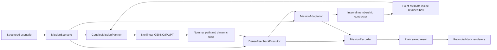

# ORBEX-A architecture

The maintained package implements physical-coordinate, nonlinear adaptive dynamic
tube MPC. Responsibilities have explicit interfaces so a change to target motion,
estimation, mission policy or rendering has a clear place to live. The public
Python namespace is `orbexa`; its source directory is the user's `scripts/`.

## Directory ownership

| Location | Responsibility |
|---|---|
| `scripts/contracts.py` | Backend-independent MPC problem/result records and model identities |
| `scripts/layout.py` | Checkout discovery and default scenario/output locations |
| `scripts/core/config_types.py` | Numeric and policy contracts for scenario sections |
| `scripts/core/config_loader.py` | YAML decoding; configuration composition is in `config.py` |
| `scripts/core/dynamics.py` | Physical LVLH translation and orbital coefficients |
| `scripts/core/orbital_parameters.py` | Immutable plant parameters; separate from the controller belief |
| `scripts/core/target_geometry.py` | Prescribed target motion, docking geometry and collision inputs |
| `scripts/core/attitude.py` | Standalone quaternion rigid-body propagation and Euler/body-rate conversion |
| `scripts/core/rigid_body_target.py` | Physical-time torque-free or gravity-gradient target propagation, proper rotations and orbital clock |
| `scripts/core/inertial_dynamics.py` | Independent Cartesian SI gravity/J2/vector-drag propagation and nonplanar LVLH transforms; explicit model-discrepancy comparison |
| `scripts/core/target_spacecraft.py`, `chaser_spacecraft.py` | Supporting spacecraft APIs; `spacecraft.py` is the base/lazy facade |
| `scripts/control/` | MPC formulation, constraints, references, dynamic tubes and uncertainty enclosures |
| `scripts/control/reachability.py` | Validated continuous held-flow and swept finite-body geometry certificates |
| `scripts/control/orbital_hold.py` | Authenticated orbital hold reconstruction and separate variation-of-constants endpoint refinement; original swept witnesses remain authoritative |
| `scripts/control/terminal_tracking.py`, `physical_terminal.py`, `continuation.py` | Exact terminal conditions, derived eccentric rigid-target bounds and stored admissible backups |
| `scripts/control/rigid_body_terminal.py`, `componentwise_terminal.py` | Full-inertia componentwise port jets and explicitly typed midpoint terminal feedback |
| `scripts/solvers/` | GEKKO, SciPy and optional CasADi implementations |
| `scripts/estimation/belief.py` | Retained parameter intervals and an admissible nominal point |
| `scripts/estimation/interval_membership.py` | Outward-rounded interval RK4 membership contraction |
| `scripts/estimation/prediction.py`, `smid.py` | Numerical prediction/observability and point-update policy |
| `scripts/solvers/gekko_estimation.py` | Symbolic local window fitting; candidate extrema are not certified enclosures |
| `scripts/estimation/mission_adaptation.py` | Dense measurement window and membership-before-point scheduling |
| `scripts/planning/` | Docking assignment, allocation and explicit supporting observation/deflection optimizers |
| `scripts/simulation/` | Scenario, fleet, phase policy, planning, execution, recording and result I/O |
| `scripts/simulation/physical_approach.py`, `certified_execution.py` | Compact finite-body target approach with explicit sensing/model admission bounds |
| `scripts/simulation/arrival_policy.py`, `mission_transition.py` | Persistent exact arrival deadline, whole-tube suffix/entry region and explicit policy-only restart seam |
| `scripts/simulation/complete_mission.py` | Stage orchestration, rigorous-clock translation propellant allowance and actual chaser-attitude handoff |
| `scripts/simulation/terminal_handoff.py` | Reproved source-bound terminal continuation, actual endpoint and separate attitude/accounting trajectory |
| `scripts/simulation/capture.py`, `assembly.py`, `propulsion.py` | Finite-reach inelastic latch, mass/inertia/fuel state and bounded external nozzle wrench allocation |
| `scripts/simulation/burn_axis.py`, `deorbit.py` | Coupled-wrench body-axis planning, bounded retrograde pointing and finite-burn orbital events |
| `scripts/simulation/chaser_attitude.py`, `detumbling.py`, `deorbit.py` | Controlled free-bus attitude, assembly detumbling and finite-burn entry-interface delivery |
| `scripts/visualization/` | Recorded-data plots, interactive views, animation, catalogs and workflow |
| `scripts/visualization/studio/` | Portable local 3D replay, synchronized charts, physical lifecycle, theory and browser video export |
| `scripts/sessions.py` | Portable session names, atomic references and protected generated-output cleanup |
| `config/default.yaml` | Default numerical scenario and mission/adaptation/solver policy |
| `paper/IEEE Aerospace Conference 2025/assets/` | User-relocated paper figures and source assets |

Paper figures retain their original content. They are publication source assets;
fresh mission galleries are generated from identified raw mission records.

## Mission composition

`ADTMPCMissionRunner` is an entrypoint around `MissionScenario`. A scenario owns
the plant truth, target, fleet initializer, phase/reference policy, safety policy,
point estimator and controller factory. Defaults are constructed explicitly;
the controller itself is created only when execution begins.



For each outer update, the runtime:

1. Selects the phase and forms moving goal/geometry previews.
2. Plans all chasers, preserving sequential warm starts, then checks simultaneous
   nominal-path separation with both chasers' tubes.
3. Advances the persistent nominal center, actual state, tube and bandwidth on
   one shared dense clock. Ancillary commands are held over each RK4 substep.
4. Checks measured containment, target exclusion, spacing and input reserves.
   When supplied, the continuous guard proves the complete held fleet motion
   before committing it, then carries the enclosure into the next hold.
5. Contracts the parameter box using the recorded dense states and held inputs.
6. Updates the nominal point without replacing that authoritative box.
7. Records whole-tube terminal bounds and requires consecutive admissible endpoints.

All chasers commit a dense transition together. Failed planning preserves the
last committed state and attempted solve diagnostics. Invalid point estimates
preserve the retained intervals and previous admissible point, mark the mission
inconsistent and retain the rejection reason.

`DynamicTubeSpec` validates shapes and numeric values before converting to the
existing `MPCProblem.extra_params['dynamic_tube']` mapping. This boundary does
not change the nonlinear backend equations. The ordinary MPC backend registry
remains separate; coupled ADTMPC rejects substitution by an ordinary solver.

## Public APIs

```python
from pathlib import Path
from orbexa.core.config import SimulationConfig
from orbexa.simulation import ADTMPCMissionRunner, MissionScenario, MissionResultStore

config = SimulationConfig.load("config/default.yaml")
scenario = MissionScenario(config=config)
result = ADTMPCMissionRunner(scenario=scenario).run(mission="single", steps=450)
MissionResultStore.save(result, Path("data/my-mission"))
```

The existing runner `run`, `save_result`, `load_result` and previous model/result
imports remain available. `CoupledTubeMission(runner)` adapts the runner's scenario;
the execution engine does not call runner implementation helpers.

To extend behavior, inject a dependency into `MissionScenario`:

- `truth`: `OrbitalPlantTruth`, including structural orbit parameters used consistently
  by the nominal dynamics and uncertainty bounds.
- `target`: the `TargetGeometry` protocol. Its collision data must be supported
  by the selected nonlinear formulation. An interface alone does not implement a
  new shape, displaced target or contact model.
- `fleet`, `reference`, `safety`: focused services for initialization, phase policy
  and measured/planned constraint checks.
- `point_estimator`: the recorded-window `PointEstimator` protocol. Its returned
  set is ignored; returned points require exact keys, finite values and membership
  in the retained box.
- `controller_factory`: creates the coupled controller with explicit backend and
  solver options. The coupled mission requires the nonlinear GEKKO formulation.

The YAML `mission`, `adaptation` and `solver` sections expose the existing policy
defaults. Orbit, MPC, target and tube sections reject malformed dimensions,
invalid bounds, incompatible weights and unsupported modes before optimization.
Configuration dataclasses are mutable; construct/load a valid configuration
when replacing a section rather than bypassing its numeric contract.

`PhysicalApproachScenario` composes compact deployment, literal COM standoff,
finite spherical buses and a physical target. Its uncertainty prior and
`ContinuousAdmissionOptions` are explicit caller inputs. The guard keeps the
original declared model prior; it does not treat a numerical contractor result
as a continuous-ODE uncertainty theorem.

`MissionCheckpoint` restores an unfinished committed prefix without changing
actual states, persistent nominal centers/tubes, beliefs, assignments or exact
guard clock. Numerical restart is an explicit source segment, with cold plans
and a reset dense adaptation window; it is separate from the certified control
continuation service. See [checkpoint compatibility](mission-checkpoint.md).

`CompleteMissionRunner` accepts an injected approach runner or an already saved
physical result. It requires successful whole-tube approach completion, debits
a conservative translation propellant allowance using Arb orbital-clock bounds,
replays actual bounded chaser attitude control, then passes those physical
attitudes and remaining tanks to `MissionLifecycle`. Capture, detumbling,
deorbit and propulsion policies remain separately injectable. `CompleteMissionStore`
reserves a new output directory and records completed stages as they become
available; later failure does not replace their evidence with a successful state.

## Recorded-data rendering

```python
from pathlib import Path
from orbexa.simulation.mission_result import MissionResultStore
from orbexa.visualization import ADTMPCMissionRenderer

raw = Path("data/my-mission/mission_data.json")
result = MissionResultStore.load(raw)
ADTMPCMissionRenderer(Path("results/my-mission"), fps=8).render(result, data_file=raw)
```

Result loading and rendering do not construct a mission runner, read scenario
YAML or import solver backends. Package exports are lazy. `visualization.demo`
remains a small compatibility facade over the dedicated workflow.

`MissionSamples` owns aligned recorded samples and frame selection. Geometry,
plots, interactive views, GIF and MP4 share those samples and target poses.
Unequal tracks stop at their common available samples with an explicit note;
they are not frozen or padded. Phase transitions and final samples are retained.
Tube boxes use each chaser's matched nominal center and component bounds.

`MissionStudio` exports an explicitly selected catalog and source hashes.
`StudioDataset` and `LifecycleDataset` project plain saved data; browser code
does not run controllers. The static renderer and equation fonts are vendored
with licenses. Browser video capture stays local. Lifecycle and approach clocks
remain distinct and their labels identify the selected physical samples.

Each artifact declares its required histories. Missing optional data skips that
view with a manifest reason while preserving other supported plots and replay.
Current model/controller markers are checked before session output changes;
contradictory identities reject, and missing markers can only be migrated from
qualified canonical raw records. Partial rendering retains other qualified families.

The animation scene is shared by GIF and MP4. MP4 uses system FFmpeg or the
optional `video` extra's local executable, within a scoped Matplotlib setting.
Encoding failures are recorded and leave no empty file. The GIF remains available.

## Supporting physical APIs

The standalone `Target` API propagates a scalar-last quaternion and body angular
velocity in seconds. Its public three-angle `curr_state` and six-value
`attitude_state` support existing consumers. Configured target Euler derivatives
per anomaly are converted at the initial orbital anomaly rate to body rates in
rad/s. `angularVelocity` explicitly supplies body rates in rad/s; `dt` is seconds.

The shared orientation convention is body-to-inertial
`Rx(roll) @ Ry(pitch) @ Rz(yaw)`. Standalone deflection optimization uses the
corresponding Euler/body-rate mapping and one bounded nonsingular Euler chart.
Quaternion propagation remains valid across Euler chart boundaries. Observation,
curve-fitting and deflection functions accept explicit inputs and own/clean their
local models, including failure paths. They do not supply hidden global parameters.

These supporting APIs remain separate from the configured approach.
`RigidBodyCylinderTarget` explicitly selects physical torque-free or
gravity-gradient attitude; `MissionLifecycle` explicitly selects modeled
attachment and controlled assembly motion. The latch is an inelastic rigid
event, not an unresolved contact-dynamics solution.

Standalone Chaser CWH planning, propagation and plots use `dt` in seconds with
anomaly scaling disabled. Its default preserves the historical numerical
`config.anom_step` value as seconds; supply `dt` to select a physical sample period.
For N Target torque intervals, N rows specify held interval inputs; N+1 rows
specify ending-node inputs, with row zero skipped. This aligns direct replay of
deflection's node force samples after conversion to body-frame torque.

## Installation and evidence

Setuptools maps `orbexa` to `scripts/` for editable installs; normal wheels
contain `orbexa/`. `run.py` bootstraps the same logical package from a checkout.
Default paths follow the checkout after relocation. Reinstall an editable package
after moving the checkout. A standalone wheel needs an explicit scenario path;
source paper assets and generated files are not wheel contents.

Repository policy keeps examples and qualification artifacts outside the checkout.
Evidence includes actual nonlinear single/fleet/fast-target missions, independent
dense numerical reconstruction, original-method and point-update equivalence,
solver failure behavior, optional-data rendering, body-rate/invariant examples,
and editable/wheel import examples. No repository test infrastructure is retained.

The ordinary YAML profile retains its analytical quadratic-drag translation and
prescribed Euler target. The physical profile and post-capture stages have
explicitly different dynamics and assumptions. Validated-flow, terminal and
continuation claims depend on the bounds and admission interfaces described in
[the mathematical formulation](theory.md); successful animation is not a proof
of those conditions. No software path claims flight-qualified release, sensing,
contact hardware, atmospheric demise or universal nonlinear solver feasibility.
