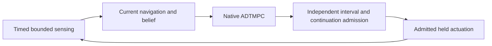

# ORBEX-A: control foundations for adaptive orbital capture

This is a teaching derivation and a map to the implementation. The maintained
mission controller is adaptive dynamic tube MPC (ADTMPC). Optional proposal
providers may seed its native nonlinear solve; none replaces nonlinear motion
admission.

Read sections 1–3 for motion, prediction and braking geometry; 4–6 for MPC,
tubes and adaptation; 7–9 for attachment, contact and online operation. Each
new symbol is defined where it first appears.

## 1. State, clocks and the physical model

For chaser $i$, let $r_i$ and $v_i$ be inertial position and velocity, $m_i$
its mass, and $F_i$ its external thrust. An inertial model has the form

$$
\dot r_i=v_i,\qquad
\dot v_i=-\mu\frac{r_i}{\|r_i\|^3}+a_{J_2}(r_i)
 +a_{D,i}(r_i,v_i)+\frac{F_i}{m_i}+w_i.
$$

Here $\mu$ is Earth's gravitational parameter; $a_{J_2}$ is the acceleration
from the second zonal gravity harmonic, $a_D$ is drag, and $w_i$ denotes
remaining bounded acceleration error. With atmospheric velocity
$v_{\rm atm}=\omega_E\times r$, the vector quadratic drag model is

$$
a_D=-\frac{\rho C_D A}{2m}\|v-v_{\rm atm}\|(v-v_{\rm atm}).
$$

Density $\rho$, drag coefficient $C_D$ and effective area $A$ need a stated
model and uncertainty domain. Treating drag as three unrelated scalar squares
loses its direction. All bodies experience gravity; thrust is not used to
cancel an artificial world gravity vector after computing a constrained input.
See [the nonlinear plant](nonlinear-mission.md) for the declared ORBEX model.

Let $R(t)$ rotate reference-frame coordinates into inertial coordinates and
$p=R^T(r_i-r_T)$ be relative position to the target. Let $\omega$ be the
reference frame's angular velocity expressed in that frame. Differentiating
twice gives

$$
\ddot p=R^T(a_i-a_T)-2\omega\times\dot p
 -\dot\omega\times p-\omega\times(\omega\times p).
$$

The Coriolis, Euler and centrifugal terms are consequences of the rotating
coordinates. They cannot be dropped while calling the resulting acceleration
an inertial command. ORBEX uses a declared reference-orbit frame and clock;
that frame is not automatically the perturbed target's instantaneous LVLH.

The optimizer can use true anomaly $q$ instead of seconds. Define
$\nu=\dot q>0$ and use a prime for $d/dq$. The clock conversion is

$$
\dot p=\nu p',\qquad
\ddot p=\nu^2p''+\dot\nu p'.
$$

Thus $p'$ has units m/rad and the acceleration-coordinate input $u_q$ has
units m/rad²; the direct physical acceleration contribution is $\nu^2u_q$.
The remaining clock and frame terms belong in the drift. A constraint written in
m/s² is **not** a row on $u_q$ until the entire transformation is made.

### A moving attachment point

Let $s$ be a fixed hull point in the target body frame, $R_T$ the body-to-inertial
rotation, and $\omega_T$ its body-frame angular velocity. Its inertial goal is

$$
g=r_T+R_Ts,\quad
\dot g=v_T+R_T(\omega_T\times s),\quad
\ddot g=a_T+R_T\{\dot\omega_T\times s+
 \omega_T\times(\omega_T\times s)\}.
$$

A moving goal and a moving obstacle share this prediction machinery. They
have different constraints: the goal defines a reachable tracking/capture
set; an obstacle defines an excluded set. Only an explicitly admitted contact
patch changes that exclusion rule. A moving solar wing does not become a
valid goal because the planner is following a nearby hull point.

## 2. The double integrator and a consistent prediction

For the local teaching model, position $p\in\mathbb R^3$, velocity
$v\in\mathbb R^3$ and commanded acceleration $u\in\mathbb R^3$ satisfy
$\dot p=v$, $\dot v=u$. Define $x=[p;v]$. Then

$$
\dot x=Ax+Bu,\quad
A=\begin{bmatrix}0&I\\0&0\end{bmatrix},\quad
B=\begin{bmatrix}0\\I\end{bmatrix}.
$$

For a zero-order-held input over duration $h$, integration is exact:

$$
x_{k+1}=A_dx_k+B_du_k,\qquad
A_d=\begin{bmatrix}I&hI\\0&I\end{bmatrix},\quad
B_d=\begin{bmatrix}\tfrac12h^2I\\hI\end{bmatrix}.
$$

Symplectic Euler instead uses $v_{k+1}=v_k+hu_k$ and
$p_{k+1}=p_k+hv_{k+1}$, giving $h^2u_k$ in its position update. That is a
different numerical method, so predicted positions from the two conventions
disagree.

`AffinePrediction` builds the ORBEX nominal RK4 map, including its
time-varying affine drift. Given $x_0$ and controls $u_k$, every proposal uses
that same map.

## 3. Shared braking references

The fleet can have a high common approach speed and much smaller differences
between chaser velocities. Braking every complete velocity over the same long
duration can still let those differences consume the inter-chaser clearance.
Refining a time enclosure cannot repair a reference whose actual tube boxes
overlap the required separation.

Let $p_{i0}$ and $v_{i0}$ be initial position and velocity in the commanded
reference frame, with derivatives taken in $q$. Define the common velocity
$v_c=N^{-1}\sum_i v_{i0}$ and relative velocity $w_i=v_{i0}-v_c$.
For a positive braking duration $T$, use

$$
b_T(\tau)=\frac{T}{4}\left[1-\left(1-\frac{\tau}{T}\right)^4\right],
\quad 0\le\tau\le T,
\qquad b_T(\tau)=T/4\quad(\tau>T).
$$

Its derivative is $(1-\tau/T)^3$, so velocity and acceleration reach zero
continuously. Let $s_T$ be the quintic unit step
$10(\tau/T)^3-15(\tau/T)^4+6(\tau/T)^5$ until $T$, then one.
With a shared outward displacement $d$, the proposed route is

$$
p_i(\tau)=p_{i0}+v_c b_{T_c}(\tau)+w_i b_{T_r}(\tau)
             +d\,s_{T_c}(\tau),\qquad 0<T_r\le T_c.
$$

The shared terms cancel in every simultaneous peer difference:

$$
p_i(\tau)-p_j(\tau)=p_{i0}-p_{j0}
                    +(v_{i0}-v_{j0})b_{T_r}(\tau).
$$

After $T_r$, the reference formation is fixed in the commanded frame while
shared braking continues. Exact rational piecewise polynomials join with
continuous position, velocity and acceleration; a finite constant-reference
holding interval follows. The implementation is
`mission/safety/braking.py`. This is a reference proposal, and the complete
nonlinear tracking, sensing, actuator, force, fuel, target-component and peer
proofs still decide admission. The tube widths and safety distances remain
unchanged. See [the finite-refuge formulation](fleet-fallback.md).

Illustrative reference algebra: changing the shared braking duration leaves
pair separation identical. These are exact polynomial references; physical
dynamics and safety admission remain separate.
[Figure data](https://orbex-a.aaronjs.me/theory/figures/braking-reference-data.json).

## 4. MPC and nonconvex geometry

For prediction length $N$, nominal states $z_k$, controls $\bar u_k$, moving
reference $r_k$ and reference input $u_{r,k}$, a quadratic tracking objective is

$$
J=\sum_{k=0}^{N-1}\big[\|z_k-r_k\|_Q^2+
 \|\bar u_k-u_{r,k}\|_R^2\big]+\|z_N-r_N\|_P^2.
$$

$\|y\|_Q^2=y^TQy$, with $Q\succeq0$ and $R\succ0$. The moving reference
and the initial state must come from the current problem, not the last episode.
MPC solves a finite horizon and applies only the admitted first portion before
replanning. Feasibility today does not imply recursive feasibility without
valid terminal, uncertainty-update and continuation arguments.

Collision avoidance around a bus, panels and appendages is nonconvex. A
single convex corridor can discard useful routes, and an empty corridor does
not prove the full mission impossible. Native GEKKO/IPOPT keeps the declared
nonlinear formulation. A proposal can improve initialization; it cannot
declare physical feasibility or change the constraints.

## 5. What the adaptive dynamic tube actually does

The nominal state is $z=[z_p;z_v]$ and the actual surrogate state is
$x=z+e$, with tracking error $e=[e_p;e_v]$. The sliding error is

$$s=e_v+\Lambda e_p,$$

where $\Lambda=\operatorname{diag}(\lambda_1,\lambda_2,\lambda_3)$ has
positive gains in the chosen independent variable. A component tube has
$|s|\le\Phi$ and $|e_p|\le\Omega$. Therefore

$$|e_v|\le\Phi+\Lambda\Omega.$$

The tube is an uncertainty/error set around a nominal path, not a spacecraft
surface and not a path the actual spacecraft must deliberately touch.

For nominal acceleration rows $\bar A_a$, interval model-error matrix
$\Delta A\ge0$, bandwidth vector $\alpha>0$ and component saturation,
the maintained ancillary feedback has the form

$$
v_a=-\bar A_a e-\Lambda e_v-
 (\Delta A|e|+\alpha\odot\Phi)\odot\operatorname{sat}(s/\Phi),
\qquad u=\bar u+v_a.
$$

$\odot$ denotes component multiplication. At a nonzero tube boundary,
$\operatorname{sat}(s_i/\Phi_i)=\operatorname{sign}(s_i)$ supplies the
comparison cancellation. The implementation handles zero-width components
explicitly rather than dividing by zero.

For ideal continuously evaluated feedback and valid residual forcing bound
$D\ge0$, the positive comparison system is

$$
\Phi'=-\alpha\odot\Phi+D,\qquad
\Omega'=-\Lambda\Omega+\Phi.
$$

With fixed bandwidth and forcing on an interval of width $H$,

$$
\Phi_{k+1}=e^{-\alpha H}\odot\Phi_k+
 \frac{1-e^{-\alpha H}}{\alpha}\odot D.
$$

The position comparison is coupled to the evolving $\Phi$. For each axis,
the exact update follows the exponential of the augmented linear system
with state $[\Omega_i,\Phi_i,1]$. Holding $\Phi$ arbitrarily at its endpoint
can underestimate the position tube. `advance_tube` uses the positive
comparison construction, not that shortcut.

### Why higher bandwidth is not free

For constant forcing, the ideal floors are
$\Phi_i\to D_i/\alpha_i$ and
$\Omega_i\to D_i/(\alpha_i\lambda_i)$. Larger bandwidth can shrink the
tube, but also increases feedback gain, sensing amplification and held-input
reserve. ADTMPC optimizes bandwidth jointly with the nominal path, subject
to allowed rates and hardware authority. It does not optimize away declared
physical uncertainty. The [ADTMPC performance paper](https://arxiv.org/abs/2012.12403)
studies that underlying tradeoff; its experimental results are not ORBEX
mission results.

### Held feedback and sensing change the forcing

ORBEX evaluates feedback at hold boundaries. Let $H$ be the maximum hold,
$E=[\Omega_{\rm peak};V_{\rm peak}]$ a declared stage error box, and
$V_{\rm peak}=\Phi_{\rm peak}+\Lambda\Omega_{\rm peak}$. Let $N=[N_p;N_v]$
be bounded state measurement error. In component absolute-value arithmetic,
one reserve contribution is

$$
R\ \ge\ (|\bar A_a|+\Delta A)E+\Lambda V_{\rm peak}
 +\alpha\odot\Phi_{\rm peak}
 +(|\bar A_a|+\Delta A)N+\Lambda N_v.
$$

This bounds the *held ancillary input*, not just its value at an endpoint.
The forcing $D$ also includes model and disturbance error, variation during
the hold, sensing, integration/reset defects and declared padding.
`control/tubes/sample_hold.py`, [the held-feedback derivation](theory.md) and
[the sensed-tube derivation](sensed-tube.md) define the complete expressions.
The reserve displayed above alone is not the complete physical proof.

If actuator tracking error satisfies $|e_{\rm act}|\le E_{\rm act}$ in the
**same input coordinates**, robust input tightening is

$$
u_{\min}+R+E_{\rm act}\ \le\ \bar u\ \le\
u_{\max}-R-E_{\rm act}.
$$

For example, a one-axis ±1 input limit, ancillary reserve 0.1 and actuator
error bound 0.2 leave at most ±0.7 for the nominal command. Putting actuator
error only in the error-tube forcing does not reserve this hardware authority.
The dedicated `applied_actuator_input_error_abs` field now makes the two roles
explicit. Backends without this formulation refuse a nonzero declaration.

## 6. Adaptation: a set of possible truths, not a fitted truth

Let $\theta$ collect uncertain physical parameters and $\Theta_k$ be the
set still consistent with the assumed prior and bounded observations. For a
held command $u_k$, interval flow $\mathcal F_H$, state measurement boxes
$Y_k,Y_{k+1}$ and declared disturbances $W$, a conceptual update is

$$
\Theta_{k+1}=\Theta_k\cap
 \{\theta:\mathcal F_H(Y_k,u_k,\theta,W)\cap Y_{k+1}\ne\varnothing\}.
$$

An interval contractor may exclude a parameter box only after proving
inconsistency under its declared enclosure arithmetic. A difficult or failed
numerical solve is **unknown**, not inconsistent. Nested sets preserve the
true parameter only if the initial set, model, sensors and enclosures cover
it. A confidence estimate is not a substitute for these assumptions.

ORBEX uses the contracted belief to tighten model-error bounds and rebuild
the tube problem. It must also preserve the conditions required by
continuation; shrinking parameter sets alone is not a proof of recursive
feasibility. The [nonlinear robust adaptive MPC framework](https://arxiv.org/abs/1911.02899)
states the additional role of compatible estimation, tube and terminal
ingredients. Its theorem does not automatically transfer to a different code.

A matched comparison needs four arms on the same independently selected
truths, sensors, release geometry, fuel and time limits:

| Belief | Feedback bandwidth | What it isolates |
| --- | --- | --- |
| Frozen | Fixed | Reference robust formulation |
| Adaptive | Fixed | Benefit/cost of parameter-set contraction |
| Frozen | Dynamic | Benefit/cost of tube/bandwidth optimization |
| Adaptive | Dynamic | Combined ADTMPC |

Count failures, refused commands and deadline misses as outcomes. Reporting
only successful arms biases the comparison.

## 7. Why attachment must not depend on reaching a tube edge

Let $z_T$ be the nominal terminal state, $\mathcal E_T$ its error set and
$\mathcal C(t)$ the admissible capture set, including relative position,
speed, attitude, mechanism reach and contact load requirements. Robust
terminal admission asks

$$z_T\oplus\mathcal E_T\subseteq\mathcal C(t),
\quad\text{equivalently}\quad z_T\in\mathcal C(t)\ominus\mathcal E_T.$$

$\oplus$ is a Minkowski sum; $\ominus$ is set erosion. For a position
tolerance ball of radius $\varepsilon_p$, goal-preview error $\eta_g$ and a
component box $|e_p|\le\Omega$, a sufficient condition is

$$\|z_{p,T}-g_T\|_2+\|\Omega_T\|_2+\eta_g\le\varepsilon_p.$$

For a terminal component box, check
$|z_{p,T}-g_T|+\Omega_T+\eta_g\le\varepsilon_p$ componentwise instead.
Physical speed needs the clock and moving-patch velocity conversion as well.
These are sufficient whole-set conditions, not requirements that $e_p$ equal
its maximum. The error's sign is unknown; planning for a lucky boundary
realization defeats the point of the robust tube.

ORBEX keeps the chaser COM/body outside the hull and uses a finite carried
mechanism to close the admitted remaining gap. The mechanism must actually
reach the patch for every admitted realization. If erosion is empty, one
must change approach geometry, reduce justified uncertainty, increase valid
mechanism reach, or alter timing. Calling the same unreachable standoff
"docked" is not a solution. See [terminal handoff](terminal-handoff.md) and
[finite contact](finite-contact.md) for the implemented declarations.

## 8. Contact, detumbling and deorbit are different dynamics

Before contact, spacecraft bodies move independently. During contact, normal
compression, damping, tangential friction, finite adhesive/bond strength,
mechanism travel and settling/load gates determine whether attachment is
accepted. Contact forces are equal and opposite; impulses change momenta.
Teleporting a chaser to a patch and declaring a rigid bond avoids this problem
rather than solving it.

After attachment, compute assembly mass, center of mass and inertia, including
parallel-axis contributions. For assembly angular velocity $\omega$, inertia
$I$ and total external torque $\tau$, the body equation is

$$I\dot\omega+\omega\times(I\omega)=\tau.$$

Thruster torque uses moment arms from the assembly COM. Internal contact
forces do not create net external torque. The environmental term must
include intrinsic torques and moments of external forces about that same COM.
With fixed inertia, rotational energy $E_r=\tfrac12\omega^TI\omega$ obeys
$\dot E_r=\omega^T\tau$. A damping torque $-K\omega$ yields negative
control power, but environmental torque, actuator saturation and changing
mass/inertia must be included before claiming monotone total energy decay.
See [mission lifecycle](mission-lifecycle.md).

For orbital lowering, inertial position $r$ and velocity $v$ give two-body
specific energy $\epsilon=\|v\|^2/2-\mu/\|r\|$, angular momentum
$h=r\times v$, semimajor axis $a=-\mu/(2\epsilon)$ and eccentricity
$e=\sqrt{1+2\epsilon\|h\|^2/\mu^2}$. Perigee radius is $a(1-e)$ for an
elliptic osculating orbit. Under perturbations these are instantaneous
osculating diagnostics, not a constant future orbit. Lowering must track
fuel, thrust, structural/contact loads, environmental dynamics and an actual
descending interface event. A descending 120 km handoff does not establish
atmospheric demise or a qualified disposal mission.

## 9. Online speed, accuracy, robustness and adaptation

These objectives interact. A shorter prediction or less frequent update can
save time but worsen routing or increase the held-error bound. A tighter
interval model can improve both accuracy and feasible progress but cost more
computation. Increasing bandwidth reduces an ideal tube while spending
control authority and amplifying sensing/hold effects.

The intended scheduling boundary is:

Keep a previously admitted continuation valid for the current state, time,
uncertainty, fuel and hold; an old successful plan is not automatically valid
now. `ProposalSeededSolver.maximum_preparation_s` can reject a late completed
proposal and records preparation time. It does **not** preempt Python or native
code. Hard online deadlines require a separate proposal worker, bounded
communication and an actuation/admission schedule with measured worst-case
behavior.

Measure end-to-end sensing, belief update, proposal, native solve, physical
admission, continuation and recording separately, then against the actual
hold deadline. Warm median inference timings do not cover startup, OS
scheduling, worst-case geometry, interval subdivision or a full eight-agent
loop. The complete 300 m physical mission and its full comparison
grid remain separate qualification obligations until their closed records
establish every stage.

