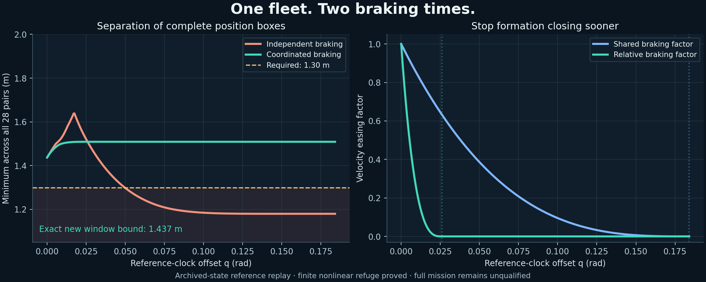
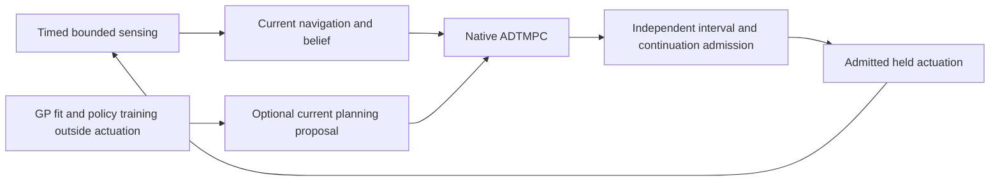

# ORBEX-A: from swarm control to adaptive orbital capture

This is a teaching derivation and a map to the implementation. The maintained
mission controller is adaptive dynamic tube MPC (ADTMPC). CLF/CBF projection,
convex MPC, consensus and learned policies supply optional planning tools; none
replaces nonlinear motion admission. The [incorporation record](swarm-consolidation.md)
accounts for the source repository and the corrections made during its transfer.

Read sections 1–5 for motion, progress and collision geometry; 6–9 for MPC,
tubes and adaptation; 10–12 for coordination and learning; 13–15 for contact
and online operation. Each new symbol is defined where it first appears.

## 1. State, clocks and the physical model

For chaser $i$, let $r_i$ and $v_i$ be inertial position and velocity, $m_i$
its mass, and $F_i$ its external thrust. An inertial model has the form

$$
\dot r_i=v_i,\qquad
\dot v_i=-\mu\frac{r_i}{\|r_i\|^3}+a_{J_2}(r_i)
 +a_{D,i}(r_i,v_i)+\frac{F_i}{m_i}+w_i.
$$

Here $\mu$ is Earth's gravitational parameter; $a_{J_2}$ is the acceleration
from the second zonal gravity harmonic, $a_D$ is drag, and $w_i$ denotes
remaining bounded acceleration error. With atmospheric velocity
$v_{\rm atm}=\omega_E\times r$, the vector quadratic drag model is

$$
a_D=-\frac{\rho C_D A}{2m}\|v-v_{\rm atm}\|(v-v_{\rm atm}).
$$

Density $\rho$, drag coefficient $C_D$ and effective area $A$ need a stated
model and uncertainty domain. Treating drag as three unrelated scalar squares
loses its direction. All bodies experience gravity; thrust is not used to
cancel an artificial world gravity vector after computing a constrained input.
See [the nonlinear plant](nonlinear-mission.md) for the declared ORBEX model.

Let $R(t)$ rotate reference-frame coordinates into inertial coordinates and
$p=R^T(r_i-r_T)$ be relative position to the target. Let $\omega$ be the
reference frame's angular velocity expressed in that frame. Differentiating
twice gives

$$
\ddot p=R^T(a_i-a_T)-2\omega\times\dot p
 -\dot\omega\times p-\omega\times(\omega\times p).
$$

The Coriolis, Euler and centrifugal terms are consequences of the rotating
coordinates. They cannot be dropped while calling the resulting acceleration
an inertial command. ORBEX uses a declared reference-orbit frame and clock;
that frame is not automatically the perturbed target's instantaneous LVLH.

The optimizer can use true anomaly $q$ instead of seconds. Define
$\nu=\dot q>0$ and use a prime for $d/dq$. The clock conversion is

$$
\dot p=\nu p',\qquad
\ddot p=\nu^2p''+\dot\nu p'.
$$

Thus $p'$ has units m/rad and the acceleration-coordinate input $u_q$ has
units m/rad²; the direct physical acceleration contribution is $\nu^2u_q$.
The remaining clock and frame terms belong in the drift. A physical-time CBF
row in m/s² is **not** a row on $u_q$ until the entire transformation is made.
The new local barrier module deliberately does not hide this conversion.

### A moving attachment point

Let $s$ be a fixed hull point in the target body frame, $R_T$ the body-to-inertial
rotation, and $\omega_T$ its body-frame angular velocity. Its inertial goal is

$$
g=r_T+R_Ts,\quad
\dot g=v_T+R_T(\omega_T\times s),\quad
\ddot g=a_T+R_T\{\dot\omega_T\times s+
 \omega_T\times(\omega_T\times s)\}.
$$

A moving goal and a moving obstacle share this prediction machinery. They
have different constraints: the goal defines a reachable tracking/capture
set; an obstacle defines an excluded set. Only an explicitly admitted contact
patch changes that exclusion rule. A moving solar wing does not become a
valid goal because the planner is following a nearby hull point.

## 2. The double integrator and a consistent prediction

For the local teaching model, position $p\in\mathbb R^3$, velocity
$v\in\mathbb R^3$ and commanded acceleration $u\in\mathbb R^3$ satisfy
$\dot p=v$, $\dot v=u$. Define $x=[p;v]$. Then

$$
\dot x=Ax+Bu,\quad
A=\begin{bmatrix}0&I\\0&0\end{bmatrix},\quad
B=\begin{bmatrix}0\\I\end{bmatrix}.
$$

For a zero-order-held input over duration $h$, integration is exact:

$$
x_{k+1}=A_dx_k+B_du_k,\qquad
A_d=\begin{bmatrix}I&hI\\0&I\end{bmatrix},\quad
B_d=\begin{bmatrix}\tfrac12h^2I\\hI\end{bmatrix}.
$$

Symplectic Euler instead uses $v_{k+1}=v_k+hu_k$ and
$p_{k+1}=p_k+hv_{k+1}$, giving $h^2u_k$ in its position update. That is a
different numerical method. The old repository used both conventions in
different planners; their predicted positions consequently disagreed.

`AffinePrediction` builds the current ORBEX nominal RK4 map, including its
time-varying affine drift. Given $x_0$ and controls $u_k$, all hints use that
same map. They do not substitute the playground's toy simulator.

## 3. Tracking and a genuine control Lyapunov function

Let $p_g,v_g,a_g$ be the moving goal's position, velocity and acceleration.
Define errors $e_p=p-p_g$, $e_v=v-v_g$. A nominal tracking preference is

$$
u_{\rm nom}=a_g-K_pe_p-K_ve_v.
$$

For positive scalar gains, the ideal error equation is
$\ddot e_p+K_v\dot e_p+K_pe_p=0$. Tracking velocity remains important at
contact; fading all damping near a spinning target does not synchronize with
the hull. PD alone imposes no obstacle or input guarantee.

A control Lyapunov function (CLF) is a scalar that an admissible control can
make decrease. Let $e=[e_p;e_v]$ and $V(e)=e^TPe$, where $P$ is symmetric
positive definite. In `QuadraticTrackingCLF`, $P$ solves the continuous-time
Riccati equation for positive design weights $Q,R$. This makes $V$ a CLF for
the unconstrained stabilizable double integrator; constraints can still
prevent its decrease. With physical drift acceleration $d$,

$$
\dot e=Ae+B(u+d-a_g),\qquad
\dot V=2e^TP\{Ae+B(d-a_g)\}+2e^TPBu.
$$

Requiring $\dot V\le-cV+\delta$, with decay $c>0$ and progress slack
$\delta\ge0$, gives an affine row on $u$. With $\delta=0$, the comparison
$V(t)\le e^{-ct}V(0)$ follows. With slack, the extra term is
$\int_0^t e^{-c(t-\tau)}\delta(\tau)d\tau$; do not claim exponential
convergence while ignoring it. The old `clf_progress.py` returned a PD
preference, without a CLF inequality. ORBEX now distinguishes these objects.

## 4. Distance safety needs a second-order barrier

For two objects, let $r=p_i-p_j$ be separation, $w=v_i-v_j$ relative velocity,
and $d>0$ the required center distance for the local spherical model. Define

$$
h(r)=r^Tr-d^2,\quad
\dot h=2r^Tw,\quad
\ddot h=2w^Tw+2r^T(u_i-u_j+d_{ij}).
$$

$d_{ij}$ is relative drift/error acceleration. A first derivative does not
contain the control: distance has relative degree two. Introduce positive
rates $\kappa_1,\kappa_2$ and the auxiliary variable
$\psi_1=\dot h+\kappa_1h$. A linear high-order CBF condition is

$$
\dot\psi_1+\kappa_2\psi_1\ge0
\iff \ddot h+(\kappa_1+\kappa_2)\dot h+
 \kappa_1\kappa_2h\ge0.
$$

The proof requires **both** $h(0)\ge0$ and $\psi_1(0)\ge0$. First the
comparison lemma gives $\psi_1(t)\ge e^{-\kappa_2t}\psi_1(0)\ge0$.
Applying it again to $\dot h+\kappa_1h\ge0$ gives
$h(t)\ge e^{-\kappa_1t}h(0)\ge0$. This assumes a sufficiently regular,
feasible control satisfying the inequality continuously and a correct model.
Being outside the obstacle initially is insufficient if the closing speed is
already too large. This is the role of the extra initial condition.

If the unknown relative acceleration lies in a component box
$|d_{ij}|\le\bar d$, its worst contribution is
$\min 2r^Td_{ij}=-2|r|^T\bar d$. For a jointly optimized pair the hard row is

$$
\begin{bmatrix}-2r^T&2r^T\end{bmatrix}
\begin{bmatrix}u_i\\u_j\end{bmatrix}
\le 2\|w\|^2+(\kappa_1+\kappa_2)\dot h+
 \kappa_1\kappa_2h-2|r|^T\bar d.
$$

For a prescribed neighbor acceleration $a_j$, move $-2r^Ta_j$ to the right
side instead. Declaring $a_j=0$ is only valid when that model or a covering
uncertainty support is justified. Rate gains have units 1/s; their product
has units 1/s². This also catches accidental clock mixing.

`HalfspaceBarrier` treats a fixed normal and a translating boundary point.
A rotating normal contributes its own first and second derivatives and is
outside that local class's contract. Envisat uses composite geometry rather
than replacing a solar wing with a safe-distance sphere.

These comparisons follow the [high-order CBF construction](https://arxiv.org/abs/1903.04706).
They do not, by themselves, prove sampled orbital collision avoidance.

## 5. Projection, braking and sample-and-hold

Collect hard barrier rows as $Gu\le b$ and hardware bounds as
$u_{\min}\le u\le u_{\max}$. Let $a_Vu\le b_V+\delta$ be the CLF row.
The small command-proposal QP is

$$
\min_{u,\delta\ge0}\ \tfrac12\|u-u_{\rm nom}\|^2+
 \tfrac12w_\delta\delta^2
\quad\text{s.t.}\quad Gu\le b,\quad u\in U,\quad a_Vu\le b_V+\delta.
$$

Only progress is softened. Soft collision rows admit collisions when their
penalty loses to another objective. `project_command` keeps them hard and
reports no command if the numerical solve fails. A returned zero acceleration
is not automatically a safe fallback for a closing pair.

For one row $a^Tu\le b$ with no other constraints, the Euclidean projection is

$$
u^*=u_{\rm nom}-\frac{(a^Tu_{\rm nom}-b)_+}{\|a\|^2}a.
$$

This follows from stationarity $u-u_{\rm nom}+\lambda a=0$, primal
feasibility and complementarity. With multiple rows or a box, active
constraints interact; clipping this one-row formula afterward is insufficient.
The [CLF/CBF QP framework](https://arxiv.org/abs/1609.06408) separates progress
and invariance in this way. ORBEX's numerical utility still needs independent
sampling, model and physical admission checks.

### Why a positive gap can already be unrecoverable

For a one-dimensional closing speed $v_c\ge0$ and constant net outward
braking acceleration $a_b>0$, stopping takes $v_c/a_b$ seconds and consumes
$v_c^2/(2a_b)$ meters. With latency $\tau$, adverse closing acceleration
$a_w\ge0$ during the delay and net braking $a_b=a_{\rm away}-a_w$ afterward,

$$
d_{\rm req}=v_c\tau+\tfrac12a_w\tau^2+
 \frac{(v_c+a_w\tau)^2}{2(a_{\rm away}-a_w)}.
$$

There is no finite stopping certificate from this model when
$a_{\rm away}\le a_w$. `BrakingEnvelope` exposes that outcome instead of
inventing a finite reserve. The formula is a diagnostic for a stated 1D
problem, not a coupled 3D viability kernel.

### A node condition is not an interval condition

Let $F(t)=\ddot h+(\kappa_1+\kappa_2)\dot h+\kappa_1\kappa_2h$ under a
held input. If a valid bound $|\dot F|\le L$ holds throughout a hold of length
$H$, then $F(t_k)\ge LH$ suffices for $F(t)\ge0$ on that hold. Obtaining $L$
requires a valid reachable-state enclosure, obstacle prediction, input and
uncertainty bounds. Evaluating it only at the initial state is circular.
See [sampled-data CBF analysis](https://arxiv.org/abs/2103.03677).
ORBEX's independent interval flows and continuation admission address the
physical model; this new local QP does not supersede them.

### Brake relative motion before the shared approach motion

The fleet can have a high common approach speed and much smaller differences
between chaser velocities. Braking every complete velocity over the same long
duration can still let those differences consume the inter-chaser clearance.
Refining a time enclosure cannot repair a reference whose actual tube boxes
overlap the required separation.

Let $p_{i0}$ and $v_{i0}$ be initial position and velocity in the commanded
reference frame, with derivatives taken in $q$. Define the common velocity
$v_c=N^{-1}\sum_i v_{i0}$ and relative velocity $w_i=v_{i0}-v_c$.
For a positive braking duration $T$, use

$$
b_T(\tau)=\frac{T}{4}\left[1-\left(1-\frac{\tau}{T}\right)^4\right],
\quad 0\le\tau\le T,
\qquad b_T(\tau)=T/4\quad(\tau>T).
$$

Its derivative is $(1-\tau/T)^3$, so velocity and acceleration reach zero
continuously. Let $s_T$ be the quintic unit step
$10(\tau/T)^3-15(\tau/T)^4+6(\tau/T)^5$ until $T$, then one.
With a shared outward displacement $d$, the proposed route is

$$
p_i(\tau)=p_{i0}+v_c b_{T_c}(\tau)+w_i b_{T_r}(\tau)
             +d\,s_{T_c}(\tau),\qquad 0<T_r\le T_c.
$$

The shared terms cancel in every simultaneous peer difference:

$$
p_i(\tau)-p_j(\tau)=p_{i0}-p_{j0}
                    +(v_{i0}-v_{j0})b_{T_r}(\tau).
$$

After $T_r$, the reference formation is fixed in the commanded frame while
shared braking continues. Exact rational piecewise polynomials join with
continuous position, velocity and acceleration; a finite constant-reference
holding interval follows. The implementation is
`simulation/fleet_braking.py`. This is a reference proposal, and the complete
nonlinear tracking, sensing, actuator, force, fuel, target-component and peer
proofs still decide admission. The tube widths and safety distances remain
unchanged. See [the finite-refuge formulation](fleet-fallback.md).



The figure uses the archived fallback endpoint immediately after a recorded
successor refusal. The refused performance projection itself was not retained.
On this adjacent state, the independent candidates allow whole-box peer
distances of 1.18–1.29 m against a strict 1.30 m requirement. The coordinated
candidate proves all 28 pairs above 1.437 m with the original 0.15 m component
position tubes, and passes the full finite nonlinear refuge constructor.
This component replay does not establish a completed mission or real-time
execution.

## 6. MPC, condensed QPs and nonconvex geometry

For prediction length $N$, nominal states $z_k$, controls $\bar u_k$, moving
reference $r_k$ and reference input $u_{r,k}$, a quadratic tracking objective is

$$
J=\sum_{k=0}^{N-1}\big[\|z_k-r_k\|_Q^2+
 \|\bar u_k-u_{r,k}\|_R^2\big]+\|z_N-r_N\|_P^2.
$$

$\|y\|_Q^2=y^TQy$, with $Q\succeq0$ and $R\succ0$. The moving reference
and the initial state must come from the current problem, not the last episode.
MPC solves a finite horizon and applies only the admitted first portion before
replanning. Feasibility today does not imply recursive feasibility without
valid terminal, uncertainty-update and continuation arguments.

For affine dynamics, stack future states in $X=[z_1;\ldots;z_N]$ and controls
in $U=[\bar u_0;\ldots;\bar u_{N-1}]$. Repeated substitution gives

$$
X=M z_0+S U+c.
$$

Substituting this into $J$ gives $\tfrac12U^THU+g^TU+\text{constant}$.
Supplied state halfspaces become linear rows on $U$, and input boxes stay
linear. `ConvexTrajectoryHint` solves this numerical proposal. Its supplied
halfspaces must already account for predicted geometry and tube support.

Collision avoidance around a bus, panels and appendages is nonconvex. A
single convex corridor can discard useful routes, and an empty corridor does
not prove the full mission impossible. Native GEKKO/IPOPT keeps the declared
nonlinear formulation. The proposal can improve initialization; it cannot
declare physical feasibility or change the constraints.

## 7. What the adaptive dynamic tube actually does

The nominal state is $z=[z_p;z_v]$ and the actual surrogate state is
$x=z+e$, with tracking error $e=[e_p;e_v]$. The sliding error is

$$s=e_v+\Lambda e_p,$$

where $\Lambda=\operatorname{diag}(\lambda_1,\lambda_2,\lambda_3)$ has
positive gains in the chosen independent variable. A component tube has
$|s|\le\Phi$ and $|e_p|\le\Omega$. Therefore

$$|e_v|\le\Phi+\Lambda\Omega.$$

The tube is an uncertainty/error set around a nominal path, not a spacecraft
surface and not a path the actual spacecraft must deliberately touch.

For nominal acceleration rows $\bar A_a$, interval model-error matrix
$\Delta A\ge0$, bandwidth vector $\alpha>0$ and component saturation,
the maintained ancillary feedback has the form

$$
v_a=-\bar A_a e-\Lambda e_v-
 (\Delta A|e|+\alpha\odot\Phi)\odot\operatorname{sat}(s/\Phi),
\qquad u=\bar u+v_a.
$$

$\odot$ denotes component multiplication. At a nonzero tube boundary,
$\operatorname{sat}(s_i/\Phi_i)=\operatorname{sign}(s_i)$ supplies the
comparison cancellation. The implementation handles zero-width components
explicitly rather than dividing by zero.

For ideal continuously evaluated feedback and valid residual forcing bound
$D\ge0$, the positive comparison system is

$$
\Phi'=-\alpha\odot\Phi+D,\qquad
\Omega'=-\Lambda\Omega+\Phi.
$$

With fixed bandwidth and forcing on an interval of width $H$,

$$
\Phi_{k+1}=e^{-\alpha H}\odot\Phi_k+
 \frac{1-e^{-\alpha H}}{\alpha}\odot D.
$$

The position comparison is coupled to the evolving $\Phi$. For each axis,
the exact update follows the exponential of the augmented linear system
with state $[\Omega_i,\Phi_i,1]$. Holding $\Phi$ arbitrarily at its endpoint
can underestimate the position tube. `advance_tube` uses the positive
comparison construction, not that shortcut.

### Why higher bandwidth is not free

For constant forcing, the ideal floors are
$\Phi_i\to D_i/\alpha_i$ and
$\Omega_i\to D_i/(\alpha_i\lambda_i)$. Larger bandwidth can shrink the
tube, but also increases feedback gain, sensing amplification and held-input
reserve. ADTMPC optimizes bandwidth jointly with the nominal path, subject
to allowed rates and hardware authority. It does not optimize away declared
physical uncertainty. The [ADTMPC performance paper](https://arxiv.org/abs/2012.12403)
studies that underlying tradeoff; its experimental results are not ORBEX
mission results.

### Held feedback and sensing change the forcing

ORBEX evaluates feedback at hold boundaries. Let $H$ be the maximum hold,
$E=[\Omega_{\rm peak};V_{\rm peak}]$ a declared stage error box, and
$V_{\rm peak}=\Phi_{\rm peak}+\Lambda\Omega_{\rm peak}$. Let $N=[N_p;N_v]$
be bounded state measurement error. In component absolute-value arithmetic,
one reserve contribution is

$$
R\ \ge\ (|\bar A_a|+\Delta A)E+\Lambda V_{\rm peak}
 +\alpha\odot\Phi_{\rm peak}
 +(|\bar A_a|+\Delta A)N+\Lambda N_v.
$$

This bounds the *held ancillary input*, not just its value at an endpoint.
The forcing $D$ also includes model and disturbance error, variation during
the hold, sensing, integration/reset defects and declared padding.
`sample_hold.py`, [the held-feedback derivation](theory.md) and
[the sensed-tube derivation](sensed-tube.md) define the complete expressions.
The reserve displayed above alone is not the complete physical proof.

If actuator tracking error satisfies $|e_{\rm act}|\le E_{\rm act}$ in the
**same input coordinates**, robust input tightening is

$$
u_{\min}+R+E_{\rm act}\ \le\ \bar u\ \le\
u_{\max}-R-E_{\rm act}.
$$

For example, a one-axis ±1 input limit, ancillary reserve 0.1 and actuator
error bound 0.2 leave at most ±0.7 for the nominal command. Putting actuator
error only in the error-tube forcing does not reserve this hardware authority.
The dedicated `applied_actuator_input_error_abs` field now makes the two roles
explicit. Backends without this formulation refuse a nonzero declaration.

## 8. Adaptation: a set of possible truths, not a fitted truth

Let $\theta$ collect uncertain physical parameters and $\Theta_k$ be the
set still consistent with the assumed prior and bounded observations. For a
held command $u_k$, interval flow $\mathcal F_H$, state measurement boxes
$Y_k,Y_{k+1}$ and declared disturbances $W$, a conceptual update is

$$
\Theta_{k+1}=\Theta_k\cap
 \{\theta:\mathcal F_H(Y_k,u_k,\theta,W)\cap Y_{k+1}\ne\varnothing\}.
$$

An interval contractor may exclude a parameter box only after proving
inconsistency under its declared enclosure arithmetic. A difficult or failed
numerical solve is **unknown**, not inconsistent. Nested sets preserve the
true parameter only if the initial set, model, sensors and enclosures cover
it. A confidence estimate is not a substitute for these assumptions.

ORBEX uses the contracted belief to tighten model-error bounds and rebuild
the tube problem. It must also preserve the conditions required by
continuation; shrinking parameter sets alone is not a proof of recursive
feasibility. The [nonlinear robust adaptive MPC framework](https://arxiv.org/abs/1911.02899)
states the additional role of compatible estimation, tube and terminal
ingredients. Its theorem does not automatically transfer to a different code.

A matched comparison needs four arms on the same independently selected
truths, sensors, release geometry, fuel and time limits:

| Belief | Feedback bandwidth | What it isolates |
| --- | --- | --- |
| Frozen | Fixed | Reference robust formulation |
| Adaptive | Fixed | Benefit/cost of parameter-set contraction |
| Frozen | Dynamic | Benefit/cost of tube/bandwidth optimization |
| Adaptive | Dynamic | Combined ADTMPC |

Count failures, refused commands and deadline misses as outcomes. Reporting
only successful arms biases the comparison.

## 9. A Gaussian process can improve a proposal, not certify its error

Let feature $\xi$ contain declared scaled observations and previous commands,
and let $y$ be measured residual acceleration after known drift and actuator
effects are accounted for. An RBF kernel with amplitude $\sigma_f$ and
length scales $\ell_j$ is

$$
k(\xi,\xi')=\sigma_f^2\exp\!\left[-\frac12\sum_j
 \frac{(\xi_j-\xi'_j)^2}{\ell_j^2}\right].
$$

Given inputs $X$, residual vector $Y$, kernel matrix $K$ and observation
noise variance $\sigma_n^2$, the posterior at $\xi_*$ is

$$
\mu_*=k_*^T(K+\sigma_n^2I)^{-1}Y,\qquad
\sigma_*^2=k_{**}-k_*^T(K+\sigma_n^2I)^{-1}k_*.
$$

The code uses Cholesky solves, not an explicit inverse, independent output
posteriors, bounded sample storage and explicit fitting. Before training it
returns nonzero prior variance. These are the standard
[GP regression equations](https://gaussianprocess.org/gpml/chapters/RW2.pdf).

For vector acceleration covariance $\Sigma$ and projected quantity $a^Ty$,
the statistical standard deviation is $\sqrt{a^T\Sigma a}$. In a distance
barrier, $a=2r$, giving $2\sqrt{r^T\Sigma r}$. A scalar GP standard deviation
cannot simply be subtracted from a barrier acceleration row without this
projection and matching units. If commands are features, a QP that changes
the command changes the query too.

A multiple of posterior deviation is not automatically a uniform physical
bound over all states, time and changing policies. ORBEX therefore keeps GP
statistics out of the authenticated SMID/tube uncertainty set. A bounded GP
mean correction may shape a warm start through `TrackingHint.correction`;
physical admission still uses the declared robust model.

## 10. Distributed MPC: agree on the same variable

Let $U$ denote the **joint** control trajectory for every chaser. Local
agents have costs/constraints $f_i(U)$ and local copies $U_i$. Consensus
optimization is

$$\min\sum_i f_i(U_i)\quad\text{s.t.}\quad U_i=Z.$$

For penalty $\rho>0$ and scaled dual variables $y_i$, synchronous ADMM uses

$$
U_i^{k+1}=\arg\min_U f_i(U)+\tfrac\rho2\|U-Z^k+y_i^k\|^2,
\quad Z^{k+1}=\frac1M\sum_i(U_i^{k+1}+y_i^k),
\quad y_i^{k+1}=y_i^k+U_i^{k+1}-Z^{k+1}.
$$

Here $M$ is the number of participating local models. All local solves see
the same previous consensus/dual snapshot. Average **copies of one joint
trajectory**, not different agents' private accelerations. Chaser 1 can
accelerate left while chaser 2 accelerates right in a valid consensus.

The primal residual is $r^k=[U_i^k-Z^k]_i$ and the dual residual is
$s^k=\rho\sqrt M(Z^k-Z^{k-1})$. Both must meet declared absolute/relative
criteria. Two iterations are a budget, not convergence. The implementation
returns `ITERATION_LIMIT` when unfinished. Convex ADMM theory requires the
conditions in the [consensus reference](https://stanford.edu/~boyd/papers/admm_distr_stats.html);
nonconvex coupled spacecraft geometry needs a separate argument.

`QuadraticProximalModel` supports local convex shared-variable problems.
`ConsensusInitialGuess` extracts an explicit chaser block from converged
joint controls, then rebuilds states using the current nominal model.
This remains a proposal for native nonlinear MPC.

### Communication connectivity

For a symmetric available-link mask and communication range $R_c$, define
$w_{ij}=(1-\|p_i-p_j\|^2/R_c^2)^2$ inside range and zero outside.
The weighted Laplacian is $L=\operatorname{diag}(W\mathbf1)-W$.
Its second eigenvalue $\lambda_2$ is positive exactly when the positive-edge
graph is connected. If that eigenvalue is simple and $v_2$ is its unit
eigenvector, the derivative with respect to $p_i$ is

$$
\nabla_{p_i}\lambda_2=\sum_j(v_{2,i}-v_{2,j})^2\nabla_{p_i}w_{ij},
\qquad
\nabla_{p_i}w_{ij}=-\frac4{R_c^2}
 (1-\|p_i-p_j\|^2/R_c^2)(p_i-p_j).
$$

At repeated eigenvalues the ordinary unique gradient is unavailable; the
code reports that explicitly. A binary k-nearest graph has locally constant
weights between topology changes, so an arbitrary attraction vector is not
its eigenvalue gradient. This module is a coordination diagnostic/preference;
range alone does not model radio outages or prove persistent connectivity.

## 11. PPO: learn the preference, keep the robust controller

A policy maps observed features $o$ to a normalized planning preference $a$.
`RelativeObservationEncoder` includes state, moving-reference error and
nearest threat summaries with explicit empty-slot masks. Observation units,
clock, scaling and ordering are part of the policy contract. Bounding-sphere
features do not replace the composite target collision model.

The optional policy uses a Gaussian latent $z\sim\mathcal N(\mu(o),\sigma^2)$
and bounded action $a=\tanh z$. Its log likelihood is

$$\log\pi(a|o)=\sum_j[\log\mathcal N(z_j;\mu_j,\sigma_j^2)
 -\log(1-\tanh^2z_j)].$$

The stable Jacobian uses
$\log(1-\tanh^2z)=2(\log2-z-\operatorname{softplus}(-2z))$.
Clipping an unbounded Gaussian action and retaining its old likelihood
describes a different executed distribution; that original implementation
was corrected.

Let reward be $r_t$, discount $\gamma$, value estimate $V_t$ and trace rate
$\lambda_{\rm GAE}$. The temporal-difference residual and generalized
advantage are

$$
\delta_t=r_t+\gamma(1-\text{terminated}_t)V_{t+1}-V_t,
\quad A_t=\delta_t+\gamma\lambda_{\rm GAE}
 (1-\text{terminated}_t)(1-\text{truncated}_t)A_{t+1}.
$$

A real terminal event has no bootstrap. A time limit truncation still
bootstraps its final observation but stops GAE from crossing the environment
reset. Value targets are $A_t+V_t$; only policy advantages are normalized.

Define likelihood ratio $r_\theta=\pi_\theta(a_t|o_t)/\pi_{\rm old}(a_t|o_t)$.
The clipped PPO objective maximizes

$$E[\min(r_\theta A_t,\operatorname{clip}(r_\theta,1-\epsilon,1+\epsilon)A_t)].$$

The code also fits the critic, estimates transformed-policy entropy, clips
gradient norm and decays the learning rate. This follows the
[PPO objective](https://arxiv.org/abs/1707.06347); none of these terms supplies
a collision guarantee. A policy fingerprint rejects stale on-policy records.

### Reward shaping and continuation

If potential $\Psi(o)=-\text{goal distance}$, policy-preserving discounted
shaping uses $F_t=\gamma\Psi(o_{t+1})-\Psi(o_t)$. The discounted sum
telescopes to $-\Psi(o_0)+\gamma^T\Psi(o_T)$. For an episodic terminal
boundary use terminal potential zero. Plain previous-distance minus
next-distance is only this expression when $\gamma=1$. Base success,
collision, effort and intervention rewards remain explicit environment terms.
Rewarded success must come from actual mission gates, not a toy radius rule.

The unmerged source branch added useful schedules, entropy controls,
exploration reset, metrics and continuation. ORBEX retains those concepts
with complete episode-boundary checkpoints: model, optimizer, own RNG,
schedule/update count, episode count, configuration and checksum manifest.
A resumed experiment forks a new log directory linked to its parent hash;
earlier histories are not truncated. Reproducibility additionally depends
on the environment reset/sensing contract and native numerical software.
The old README mentioned SAC, but no SAC implementation was found to port.

## 12. Why attachment must not depend on reaching a tube edge

Let $z_T$ be the nominal terminal state, $\mathcal E_T$ its error set and
$\mathcal C(t)$ the admissible capture set, including relative position,
speed, attitude, mechanism reach and contact load requirements. Robust
terminal admission asks

$$z_T\oplus\mathcal E_T\subseteq\mathcal C(t),
\quad\text{equivalently}\quad z_T\in\mathcal C(t)\ominus\mathcal E_T.$$

$\oplus$ is a Minkowski sum; $\ominus$ is set erosion. For a position
tolerance ball of radius $\varepsilon_p$, goal-preview error $\eta_g$ and a
component box $|e_p|\le\Omega$, a sufficient condition is

$$\|z_{p,T}-g_T\|_2+\|\Omega_T\|_2+\eta_g\le\varepsilon_p.$$

For a terminal component box, check
$|z_{p,T}-g_T|+\Omega_T+\eta_g\le\varepsilon_p$ componentwise instead.
Physical speed needs the clock and moving-patch velocity conversion as well.
These are sufficient whole-set conditions, not requirements that $e_p$ equal
its maximum. The error's sign is unknown; planning for a lucky boundary
realization defeats the point of the robust tube.

ORBEX keeps the chaser COM/body outside the hull and uses a finite carried
mechanism to close the admitted remaining gap. The mechanism must actually
reach the patch for every admitted realization. If erosion is empty, one
must change approach geometry, reduce justified uncertainty, increase valid
mechanism reach, or alter timing. Calling the same unreachable standoff
"docked" is not a solution. See [terminal handoff](terminal-handoff.md) and
[finite contact](finite-contact.md) for the implemented declarations.

## 13. Contact, detumbling and deorbit are different dynamics

Before contact, spacecraft bodies move independently. During contact, normal
compression, damping, tangential friction, finite adhesive/bond strength,
mechanism travel and settling/load gates determine whether attachment is
accepted. Contact forces are equal and opposite; impulses change momenta.
Teleporting a chaser to a patch and declaring a rigid bond avoids this problem
rather than solving it.

After attachment, compute assembly mass, center of mass and inertia, including
parallel-axis contributions. For assembly angular velocity $\omega$, inertia
$I$ and total external torque $\tau$, the body equation is

$$I\dot\omega+\omega\times(I\omega)=\tau.$$

Thruster torque uses moment arms from the assembly COM. Internal contact
forces do not create net external torque. The environmental term must
include intrinsic torques and moments of external forces about that same COM.
With fixed inertia, rotational energy $E_r=\tfrac12\omega^TI\omega$ obeys
$\dot E_r=\omega^T\tau$. A damping torque $-K\omega$ yields negative
control power, but environmental torque, actuator saturation and changing
mass/inertia must be included before claiming monotone total energy decay.
See [mission lifecycle](mission-lifecycle.md).

For orbital lowering, inertial position $r$ and velocity $v$ give two-body
specific energy $\epsilon=\|v\|^2/2-\mu/\|r\|$, angular momentum
$h=r\times v$, semimajor axis $a=-\mu/(2\epsilon)$ and eccentricity
$e=\sqrt{1+2\epsilon\|h\|^2/\mu^2}$. Perigee radius is $a(1-e)$ for an
elliptic osculating orbit. Under perturbations these are instantaneous
osculating diagnostics, not a constant future orbit. Lowering must track
fuel, thrust, structural/contact loads, environmental dynamics and an actual
descending interface event. A descending 120 km handoff does not establish
atmospheric demise or a qualified disposal mission.

## 14. Online speed, accuracy, robustness and adaptation

These objectives interact. A shorter prediction or less frequent update can
save time but worsen routing or increase the held-error bound. A tighter
interval model can improve both accuracy and feasible progress but cost more
computation. Increasing bandwidth reduces an ideal tube while spending
control authority and amplifying sensing/hold effects. Learning may improve
initialization without proving its own errors bounded.

The intended scheduling boundary is:



Use a small fixed-capacity GP posterior for inference; publish a complete
posterior only after fitting. Train PPO separately and use a fixed policy
snapshot for each proposal. Bound ADMM and QP iterations; report unfinished
coordination explicitly. Keep a previously admitted continuation valid for
the current state, time, uncertainty, fuel and hold; an old successful plan
is not automatically valid now.

`ProposalSeededSolver.maximum_preparation_s` can reject a late completed
proposal and records preparation time. It does **not** preempt Python or
native code. Hard online deadlines require a separate proposal worker,
bounded communication and an actuation/admission schedule with measured
worst-case behavior. The default mission does not silently enable any of
these optional learners or proposals.

Measure end-to-end sensing, belief update, proposal, native solve, physical
admission, continuation and recording separately, then against the actual
hold deadline. Warm median inference timings do not cover startup, OS
scheduling, worst-case geometry, interval subdivision or a full eight-agent
loop. The numerical examples in the incorporation record are component
evidence only. The complete 300 m physical mission and its full comparison
grid remain separate qualification obligations until their closed records
establish every stage.

## 15. Use the modules and generate the figures

Supply a provider explicitly when constructing a controller:

```python
from orbexa.control.mpc_controller import MPCController
from orbexa.planning.trajectory_hints import TrackingHint

# Use the constructor's normal dynamics/configuration arguments, plus:
# controller = MPCController(..., proposal_provider=TrackingHint(...))
# Gains and reference inputs use that MPCProblem's frame and clock.
```

For direct solver use:

```python
from orbexa.solvers.gekko_solver import GekkoSolver
from orbexa.solvers.proposal_seed import ProposalSeededSolver
from orbexa.planning.trajectory_hints import ConvexTrajectoryHint

solver = ProposalSeededSolver(
    GekkoSolver({"remote": False}), ConvexTrajectoryHint(),
    maximum_preparation_s=0.05,
)
# result = solver.solve_problem(current_problem)
# Inspect result.success, native residuals, and planning_proposal timing.
# Physical application still requires the maintained admission pipeline.
```

The optional `learning` extra installs PyTorch. Default runtime imports do
not construct a policy or begin training. A custom training environment must
call the maintained simulator and its motion gates; the generic training
loop supplies no physical environment on its own.

Generate a self-contained gallery in an ignored output directory:

```python
from orbexa.visualization.control_figures import ControlFoundationsFigures
ControlFoundationsFigures().export("data/control-foundations-figures")
# Open data/control-foundations-figures/index.html.
```

The gallery contains braking viability, hard-row command projection,
whole-tube capture, GP statistical uncertainty, actual convex ADMM residuals
and an explicitly ideal continuous tube comparison. Its figures and checksum
manifest are teaching artifacts; they never stand in for mission plots.
